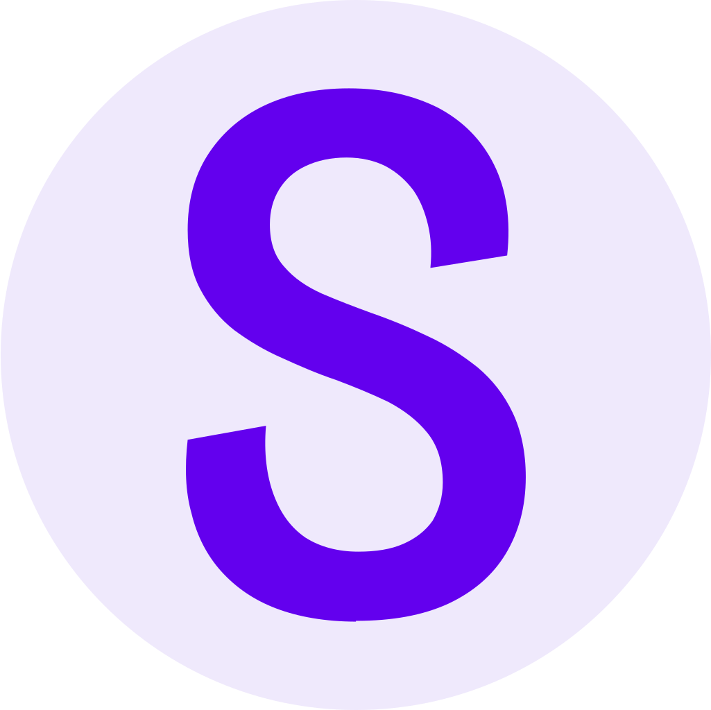

<p align="center">
    
</p>

<h1 align="center">Stund</h1>
<h3 align="center">Activity-Enriched Collaborative Workspaces Mediated by Artificial Intelligence</h3>
<br/>


## About

Stund is an activity-enriched collaborative workspace mediated by artificial intelligence. It builds on the Webstrates platform including [Webstrates](https://www.webstrates.net/) and [Codestrates](https://codestrates.projects.cavi.au.dk/).

Stund consists of a Webstrates-based web [client](client) and an activity session [server](server). Without an activity session server, the client only supports the material substrate with a 2D canvas and a chat that can interact with it.


## Repository Structure

| Folder                   | Description                                                                                                       |
| ------------------------ | ----------------------------------------------------------------------------------------------------------------- |
| [`client`](client)       | The Webstrates-based web client with the collaborative 2D canvas and the AI chat.                                 |
| [`server`](server)       | The activity session server (SessionHistoryServer) that records and processes sessions as timed events and media. |
| [`resources`](resources) | Shared resources such as the Stund logo.                                                                          |


## Getting Started

1. Create an instance of the client on any Webstrates server as described in the [client README](client/README.md).
2. Run an activity session server as described in the [server README](server/README.md). The server is required for all history features, such as recording, transcription, and the activity history.


## Documentation

Find the documentation of the client in the [client/docs](client/docs) folder and the documentation of the server in the [server README](server/README.md).


## Research Paper ([PDF](https://pure.au.dk/ws/portalfiles/portal/472319208/StundUIST2026AuthorsCopy.pdf), [Video](https://www.youtube.com/watch?v=QjgDFruIFh0))

> Marcel Borowski, Janus Bager Kristensen, Payod Panda, Sean Rintel, Niklas Elmqvist, Jens Emil Sloth Grønbæk, and Clemens Nylandsted Klokmose. 2026. Stund: Activity-Enriched Collaborative Workspaces Mediated by Artificial Intelligence. In *Proceedings of the 39th Annual ACM Symposium on User Interface Software and Technology (UIST ’26)*. Association for Computing Machinery, New York, NY, USA, Article 119, 14 pages. DOI: [10.1145/3830398.3830508](https://doi.org/10.1145/3830398.3830508).


## Citation

If you use Stund in your research, please cite the paper. Machine-readable citation metadata for the software and the paper is available in [CITATION.cff](CITATION.cff) (shown as "Cite this repository" on GitHub).

```bibtex
@inproceedings{Stund2026,
    author = {Borowski, Marcel and Kristensen, Janus Bager and Panda, Payod and Rintel, Sean and Elmqvist, Niklas and Gr{\o}nb{\ae}k, Jens Emil Sloth and Klokmose, Clemens Nylandsted},
    title = {Stund: Activity-Enriched Collaborative Workspaces Mediated by Artificial Intelligence},
    year = {2026},
    isbn = {9798400728563},
    publisher = {Association for Computing Machinery},
    address = {New York, NY, USA},
    url = {https://doi.org/10.1145/3830398.3830508},
    doi = {10.1145/3830398.3830508},
    booktitle = {Proceedings of the 39th Annual ACM Symposium on User Interface Software and Technology},
    articleno = {119},
    numpages = {14},
    keywords = {Activity-Enriched Computing, Collaboration, Substrates, Malleable Software, Reification, AI-as-Medium},
    location = {Detroit, Michigan, USA},
    series = {UIST '26}
}
```


## License

Stund is released under the MIT License — see [LICENSE](LICENSE). The exceptions are listed in the LICENSE file:

- The vendored `gst1-java-fixups` jars in [`server/libs`](server/libs) are licensed under the GNU LGPL version 3 only (see [server/libs/LICENSE](server/libs/LICENSE) and [server/THIRD-PARTY-NOTICES.txt](server/THIRD-PARTY-NOTICES.txt)).
- A few components embedded in the client (WPMv2, SlopScript, and FragmentFilesystemSync) are licensed under the Apache License 2.0 (see [client/licenses/Apache-2.0.txt](client/licenses/Apache-2.0.txt)).

Run-time dependencies are not distributed with this repository and keep their own licenses. In particular, [tldraw](https://tldraw.dev/), which the client uses for the 2D canvas, is not open source: its [license](https://github.com/tldraw/tldraw/blob/main/LICENSE.md) requires a license key for production use (see the [client README](client/README.md#third-party-components)).
